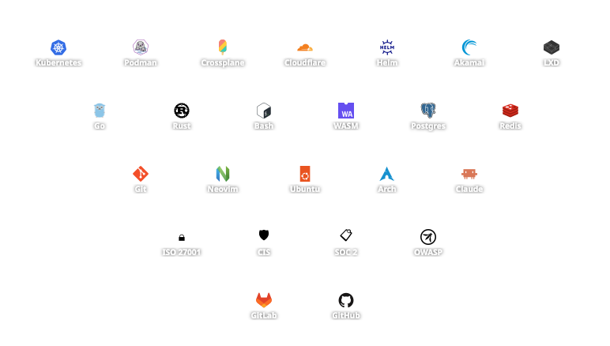

<table border="0">
<tr>
<td valign="top" width="260">

<pre>

    ⠀⠀⠀⠀⠀⠀⠀⠀⠀⠀⠀⠀⣀⣴⣾⣷⣤⣀⠀⠀⠀⠀⠀⠀⠀⠀⠀⠀⠀⠀
    ⠀⠀⠀⠀⠀⠀⠀⠀⢀⣠⣴⡿⠟⠋⠀⠈⠙⠻⣷⣦⣄⠀⠀⠀⠀⠀⠀⠀⠀⠀
    ⠀⠀⠀⠀⠀⢀⣤⡀⠹⠛⠉⠀⣠⣴⣿⣷⣦⣀⠀⠉⠻⠏⢠⣄⡀⠀⠀⠀⠀⠀
    ⠀⠀⣀⣴⣾⠿⠋⠁⠀⠀⠀⠛⠉⢹⣿⣿⡇⠉⠓⠀⠀⠀⠈⠛⢿⣷⣤⣀⠀⠀
    ⣴⡿⠟⠋⠀⣀⣤⠶⠀⠀⠀⠀⠀⢸⣿⣿⠃⠀⠀⠀⠀⠀⠶⣄⡀⠈⠙⠻⣷⣦
    ⣿⡇⠀⣴⣾⣿⣤⡀⠀⠀⠀⠀⠀⠈⣿⣿⠀⠀⠀⠀⠀⠀⢀⣼⣿⣷⡆⠀⢸⣿
    ⣿⡇⠀⣿⢿⣿⣿⣿⣶⣄⠀⠀⢀⣤⣿⣿⣤⡀⠀⢀⣠⣾⣿⣿⣿⣿⡇⠀⢸⣿
    ⣿⡇⠀⣿⠀⠈⠉⠛⠿⣿⣿⣾⣿⣿⣿⣿⣿⣿⣷⣿⣿⠿⠛⠉⠀⠘⡇⠀⢸⣿
    ⠿⠇⠀⠀⠀⠀⠀⠀⠀⠀⣿⣿⣿⣿⣿⣿⣿⣿⣿⣿⠀⠀⠀⠀⠀⠀⠀⠀⠸⠟
    ⣶⡆⠀⠀⠀⠀⠀⠀⠀⠀⣿⣿⣿⣿⣿⣿⣿⣿⣿⣿⠀⠀⠀⠀⠀⠀⠀⠀⢰⣶
    ⣿⡇⠀⣿⠀⢀⣀⣤⣶⣿⣿⢿⣿⣿⣿⣿⣿⣿⡿⣿⣿⣶⣤⣀⠀⢸⡇⠀⢸⣿
    ⣿⡇⠀⣿⣾⣿⣿⣿⠿⠋⠀⠀⠈⠛⣿⣿⠋⠁⠀⠈⠙⢿⣿⣿⣿⣿⡇⠀⢸⣿
    ⣿⡇⠀⠻⢿⣿⠛⠁⠀⠀⠀⠀⠀⢠⣿⣿⠀⠀⠀⠀⠀⠀⠈⢻⣿⡿⠇⠀⢸⣿
    ⠻⣿⣦⣄⡀⠉⠛⠶⠀⠀⠀⠀⠀⢸⣿⣿⡄⠀⠀⠀⠀⠀⠶⠋⠁⢀⣠⣶⡿⠟
    ⠀⠀⠉⠛⢿⣶⣤⡀⠀⠀⠀⣤⣀⣸⣿⣿⡇⣀⡤⠀⠀⠀⢀⣤⣾⡿⠛⠁⠀⠀
    ⠀⠀⠀⠀⠀⠈⠙⠁⣰⣦⣀⠀⠙⠻⣿⡿⠟⠉⠀⣀⣴⣆⠘⠋⠁⠀⠀⠀⠀⠀
    ⠀⠀⠀⠀⠀⠀⠀⠀⠈⠙⠻⣿⣦⣄⠀⢀⣠⣴⡿⠟⠋⠀⠀⠀⠀⠀⠀⠀⠀⠀
    ⠀⠀⠀⠀⠀⠀⠀⠀⠀⠀⠀⠀⠉⠻⢿⡿⠛⠉⠀⠀⠀⠀⠀⠀⠀⠀⠀⠀⠀⠀

               G A L A C T I C
                 E M P I R E
</pre>

</td>
<td valign="top">

<pre>
 jemo121@F--Winblows
 ───────────────────────────────
 OS        CachyOS (Arch BTW)
 Kernel    Linux
 Shell     Fish · Bash
 Editor    Neovim + LazyVim
 Terminal  Kitty
 ───────────────────────────────
 Focus     Blue Team
           DevSecOps
           Cloud Native
           Junior Gamer
 ───────────────────────────────
 Hobbies   <a href="https://open.spotify.com/playlist/0IzjHHwukkpAPrEZy4hi9q?si=e124bdb5627f46c5" target="_blank">Music</a>
           Swimming
           Judo
           <a href="https://www.chess.com/member/jemo121" target="_blank">Chess</a>
           Boardgames
           <a href="https://steamcommunity.com/id/Jemo121/" target="_blank">Gaming</a>
 ───────────────────────────────
 Website   <a href="https://emilio.eguia.me" target="_blank">emilio.eguia.me</a>
 GitLab    <a href="https://gitlab.com/jemo121" target="_blank">gitlab.com/jemo121</a>
 GitHub    <a href="https://github.com/Jemo121" target="_blank">github.com/Jemo121</a>
 LinkedIn  <a href="https://linkedin.com/in/emilio-e-b4350624a/" target="_blank">emilio-e-b4350624a</a>
</pre>

</td>
</tr>
</table>

---

 

 
 

 

 

 

 

## Stats

 

 

 

## Projects

 👇 Check out the things I am working on 👇 

